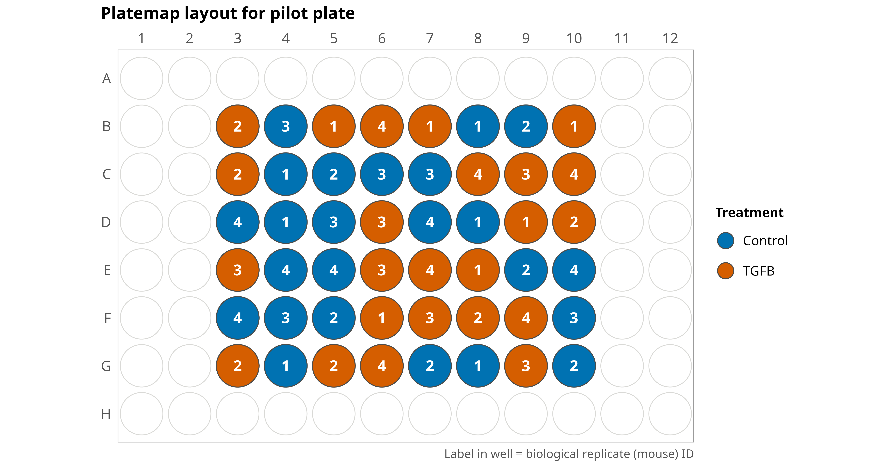

# Predicting cardiac fibrosis from mouse fibroblasts

This repository contains image analysis, image-based profiling, and machine learning pipelines to predict cardiac fibrosis signature from mouse fibroblasts.

## Plate map details

There is one pilot plate in this dataset with 48 wells of mouse cardiac fibroblasts.
Half of the wells (24) are treated with TGF-β to induce a fibrotic phenotype and the other half are treated with vehicle (control).
There are four biological replicates (N1-N4), where each ID represents fibroblasts from a different mouse.
Each biological replicate has six wells per treatment, and 25 sites (fields of view) are imaged per well.

For this dataset, the Cell Painting staining swaps the cytoplasmic RNA/nucleoli stain for a specific F-actin stain to image the following organelles (with mapping to respective channel):

- Nuclei (d4)
- Endoplasmic Reticulum (d3)
- Golgi (d2)
- Mitochondria (d1)
- F-actin (d0)



> Plate map layout for the pilot plate. Well color shows the treatment and the label in the well is the biological replicate (mouse) ID.

## Modules

| Module | Purpose | Description |
| :---- | :----- | :---------- |
| [metadata](./metadata/) | Plate map | Plate map file and code to generate the plate map figure. |
| [0.illumination_correction](./0.illumination_correction/) | Whole image QC & illumination correction | Remove over-saturated image sets and calculate illumination correction functions per channel using CellProfiler. |
| [1.cellprofiler_processing](./1.cellprofiler_processing/) | Segmentation & feature extraction | Apply illumination correction, segment nuclei, cells, and cytoplasm, and extract morphology features using CellProfiler. |
| [2.preprocessing_features](./2.preprocessing_features/) | Image-based profiling | Convert CellProfiler outputs to parquet with CytoTable, flag poor-quality segmentations with coSMicQC, and generate normalized, feature-selected single-cell and well-level (bulk) profiles with pycytominer. |
| [3.machine_learning](./3.machine_learning/) | Machine learning | Train a binary logistic regression to predict TGF-β versus vehicle treated single cells, holding out one biological replicate and one random well per remaining replicate, then extract and plot model performance and top features (coefficients), and generate a single-cell crop montage of top predicted cells. |

## Environments

We utilize environments defined in the [environments folder](./environments/).
Python environments are managed with [uv](https://docs.astral.sh/uv/), while the CellProfiler and R environments are managed with conda/mamba.

1. [CellProfiler environment](./environments/cellprofiler_env.yml) (conda): This environment installs CellProfiler, which we use for the illumination correction and feature extraction modules.
2. [R environment](./environments/r_fibrosis_env.yml) (conda): This environment is specific to R, which we use for generating figures.
3. [Preprocessing environment](./environments/preprocessing_env/) (uv): This environment installs preprocessing softwares (pycytominer, CytoTable, coSMicQC) to format the morphological readouts as single-cell profiles.
4. [Machine learning environment](./environments/machine_learning_env/) (uv): This environment is used for training and evaluating machine learning models.

> [!NOTE]
> We keep the CellProfiler and R environments in conda/mamba instead of moving them to uv.
> uv only manages Python packages, so it cannot install R or R packages.
> CellProfiler relies on system libraries outside of Python (Java, GTK, and MySQL) and pinned older package versions that conda installs reliably.
> Keeping both in conda means they work as is and can also be used on HPC systems.

To install the conda environments, run the following from the root of this repository:

```bash
mamba env create -f environments/cellprofiler_env.yml
mamba env create -f environments/r_fibrosis_env.yml
```

To install the uv environments, run the following from the root of this repository:

```bash
uv sync --project environments/preprocessing_env
uv sync --project environments/machine_learning_env
```

Each uv environment is created as a `.venv` folder within its project folder.
To run code with a uv environment, either activate it (e.g., `source environments/preprocessing_env/.venv/bin/activate`) or use `uv run --project environments/preprocessing_env <command>`.
