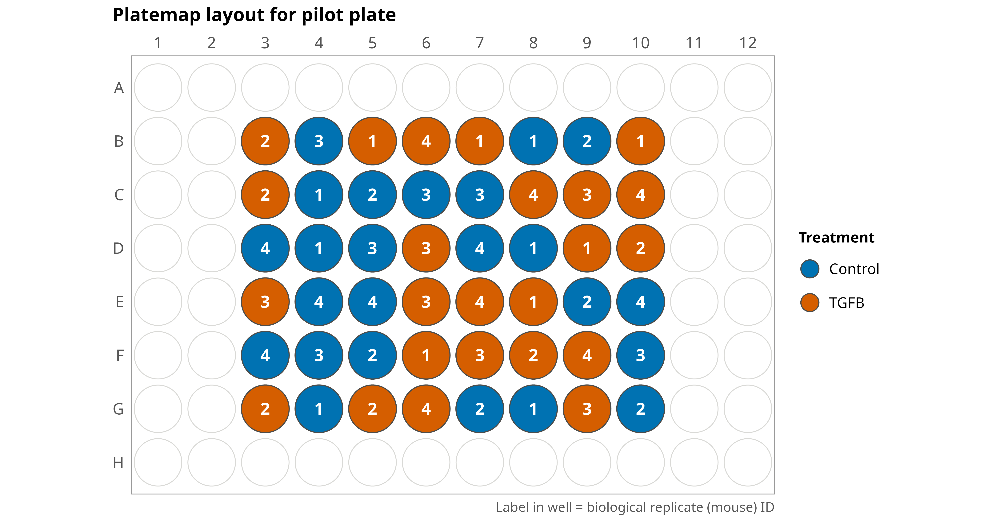

# Plate map metadata

In this module, we store the plate map for the pilot plate and generate a figure of the plate layout.

## Plate map

The [pilot_platemap.csv](./platemaps/pilot_platemap.csv) file has one row per well with the following columns:

| Column | Description |
| --- | --- |
| WellRow | Plate row (B-G) |
| WellCol | Plate column (3-10) |
| well_position | Well ID (e.g., B03), used to join the plate map to the profiles |
| Treatment | `TGFB` (TGF-β to induce a fibrotic phenotype) or `Veh` (vehicle control) |
| N_Replicate | Biological replicate (N1-N4), where each ID is fibroblasts from a different mouse |

## Plate map figure

The notebook [platemap_vis.ipynb](./platemap_vis.ipynb) uses R (ggplot2 and platetools) to plot the plate map as a 96-well plate, where well color shows the treatment and the label in each well is the biological replicate ID.
The figure is saved to the [platemap_fig](./platemap_fig/) folder.

> Plate map layout for the pilot plate. Well color shows the treatment and the label in the well is the biological replicate (mouse) ID.

To generate the figure, run the notebook using the R environment (`mouse_r_fibrosis_env`).
